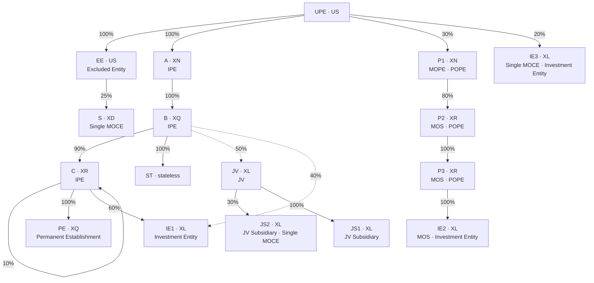

# Example

A single ownership structure of 17 Entities, headed by a US UPE, that exercises every classification in [JV](JV.md), [MOSG](MOSG.md), [Group](Group.md), and [Taxing Rights](<Taxing Rights.md>). Jurisdiction codes other than US are placeholders, and their implementation statuses are assumptions.

# Jurisdictions

| Code | IIR | Qualified IIR | Domestic IIR | UTPR | QDMTT |
| --- | --- | --- | --- | --- | --- |
| US | – | – | – | – | – |
| XN | ✓ | – | – | – | – |
| XQ | ✓ | ✓ | ✓ | ✓ | ✓ |
| XR | ✓ | ✓ | – | – | – |
| XD | – | – | – | – | ✓ |
| XL | – | – | – | – | – |

# Ownership Structure

A solid arrow is a direct Ownership Interest held together with direct control; a dashed arrow is an Ownership Interest without control. The arrow from C to itself is treasury shares. Interests not shown are held outside the group. JV is reported under the equity method and has no controller.

# Matrices

Rows and columns follow the Entity index $i$ in [Entities](#entities). Rows are owning or controlling Entities; blank cells are 0.

**Direct Ownership Interest matrix** $\mathbf{X}_0$

| | 1 | 2 | 3 | 4 | 5 | 6 | 7 | 8 | 9 | 10 | 11 | 12 | 13 | 14 | 15 | 16 | 17 |
| --- | --- | --- | --- | --- | --- | --- | --- | --- | --- | --- | --- | --- | --- | --- | --- | --- | --- |
| **1 UPE** |  | 1 | 1 |  |  |  |  |  |  |  |  | 0.3 |  |  |  |  | 0.2 |
| **2 EE** |  |  |  |  |  |  |  |  |  |  |  |  |  |  |  | 0.25 |  |
| **3 A** |  |  |  | 1 |  |  |  |  |  |  |  |  |  |  |  |  |  |
| **4 B** |  |  |  |  | 0.9 |  | 0.4 | 1 | 0.5 |  |  |  |  |  |  |  |  |
| **5 C** |  |  |  |  | 0.1 | 1 | 0.6 |  |  |  |  |  |  |  |  |  |  |
| **6 PE** |  |  |  |  |  |  |  |  |  |  |  |  |  |  |  |  |  |
| **7 IE1** |  |  |  |  |  |  |  |  |  |  |  |  |  |  |  |  |  |
| **8 ST** |  |  |  |  |  |  |  |  |  |  |  |  |  |  |  |  |  |
| **9 JV** |  |  |  |  |  |  |  |  |  | 1 | 0.3 |  |  |  |  |  |  |
| **10 JS1** |  |  |  |  |  |  |  |  |  |  |  |  |  |  |  |  |  |
| **11 JS2** |  |  |  |  |  |  |  |  |  |  |  |  |  |  |  |  |  |
| **12 P1** |  |  |  |  |  |  |  |  |  |  |  |  | 0.8 |  |  |  |  |
| **13 P2** |  |  |  |  |  |  |  |  |  |  |  |  |  | 1 |  |  |  |
| **14 P3** |  |  |  |  |  |  |  |  |  |  |  |  |  |  | 1 |  |  |
| **15 IE2** |  |  |  |  |  |  |  |  |  |  |  |  |  |  |  |  |  |
| **16 S** |  |  |  |  |  |  |  |  |  |  |  |  |  |  |  |  |  |
| **17 IE3** |  |  |  |  |  |  |  |  |  |  |  |  |  |  |  |  |  |

**Direct and indirect Ownership Interest matrix** $\mathbf{Y}=f(\mathbf{X}_0)$

| | 1 | 2 | 3 | 4 | 5 | 6 | 7 | 8 | 9 | 10 | 11 | 12 | 13 | 14 | 15 | 16 | 17 |
| --- | --- | --- | --- | --- | --- | --- | --- | --- | --- | --- | --- | --- | --- | --- | --- | --- | --- |
| **1 UPE** |  | 1 | 1 | 1 | 1 | 1 | 1 | 1 | 0.5 | 0.5 | 0.15 | 0.3 | 0.24 | 0.24 | 0.24 | 0.25 | 0.2 |
| **2 EE** |  |  |  |  |  |  |  |  |  |  |  |  |  |  |  | 0.25 |  |
| **3 A** |  |  |  | 1 | 1 | 1 | 1 | 1 | 0.5 | 0.5 | 0.15 |  |  |  |  |  |  |
| **4 B** |  |  |  |  | 1 | 1 | 1 | 1 | 0.5 | 0.5 | 0.15 |  |  |  |  |  |  |
| **5 C** |  |  |  |  | 0.1 | 1 | 0.6 |  |  |  |  |  |  |  |  |  |  |
| **6 PE** |  |  |  |  |  |  |  |  |  |  |  |  |  |  |  |  |  |
| **7 IE1** |  |  |  |  |  |  |  |  |  |  |  |  |  |  |  |  |  |
| **8 ST** |  |  |  |  |  |  |  |  |  |  |  |  |  |  |  |  |  |
| **9 JV** |  |  |  |  |  |  |  |  |  | 1 | 0.3 |  |  |  |  |  |  |
| **10 JS1** |  |  |  |  |  |  |  |  |  |  |  |  |  |  |  |  |  |
| **11 JS2** |  |  |  |  |  |  |  |  |  |  |  |  |  |  |  |  |  |
| **12 P1** |  |  |  |  |  |  |  |  |  |  |  |  | 0.8 | 0.8 | 0.8 |  |  |
| **13 P2** |  |  |  |  |  |  |  |  |  |  |  |  |  | 1 | 1 |  |  |
| **14 P3** |  |  |  |  |  |  |  |  |  |  |  |  |  |  | 1 |  |  |
| **15 IE2** |  |  |  |  |  |  |  |  |  |  |  |  |  |  |  |  |  |
| **16 S** |  |  |  |  |  |  |  |  |  |  |  |  |  |  |  |  |  |
| **17 IE3** |  |  |  |  |  |  |  |  |  |  |  |  |  |  |  |  |  |

- C holds 10% of itself, so B's 90% is the whole of the outstanding interest: $(\mathbf{Y})_{4,5}=1$, and the treasury shares remain on the diagonal as $(\mathbf{Y})_{5,5}=0.1$.
- IE1 has two shareholders: $(\mathbf{Y})_{4,7}=0.4+1\times0.6=1$ for B, and $(\mathbf{Y})_{5,7}=0.6$ for C.

**Direct Controlling Interest matrix** $\mathbf{C}_0$

| | 1 | 2 | 3 | 4 | 5 | 6 | 7 | 8 | 9 | 10 | 11 | 12 | 13 | 14 | 15 | 16 | 17 |
| --- | --- | --- | --- | --- | --- | --- | --- | --- | --- | --- | --- | --- | --- | --- | --- | --- | --- |
| **1 UPE** |  | 1 | 1 |  |  |  |  |  |  |  |  | 1 |  |  |  |  | 1 |
| **2 EE** |  |  |  |  |  |  |  |  |  |  |  |  |  |  |  | 1 |  |
| **3 A** |  |  |  | 1 |  |  |  |  |  |  |  |  |  |  |  |  |  |
| **4 B** |  |  |  |  | 1 |  |  | 1 |  |  |  |  |  |  |  |  |  |
| **5 C** |  |  |  |  |  | 1 | 1 |  |  |  |  |  |  |  |  |  |  |
| **6 PE** |  |  |  |  |  |  |  |  |  |  |  |  |  |  |  |  |  |
| **7 IE1** |  |  |  |  |  |  |  |  |  |  |  |  |  |  |  |  |  |
| **8 ST** |  |  |  |  |  |  |  |  |  |  |  |  |  |  |  |  |  |
| **9 JV** |  |  |  |  |  |  |  |  |  | 1 | 1 |  |  |  |  |  |  |
| **10 JS1** |  |  |  |  |  |  |  |  |  |  |  |  |  |  |  |  |  |
| **11 JS2** |  |  |  |  |  |  |  |  |  |  |  |  |  |  |  |  |  |
| **12 P1** |  |  |  |  |  |  |  |  |  |  |  |  | 1 |  |  |  |  |
| **13 P2** |  |  |  |  |  |  |  |  |  |  |  |  |  | 1 |  |  |  |
| **14 P3** |  |  |  |  |  |  |  |  |  |  |  |  |  |  | 1 |  |  |
| **15 IE2** |  |  |  |  |  |  |  |  |  |  |  |  |  |  |  |  |  |
| **16 S** |  |  |  |  |  |  |  |  |  |  |  |  |  |  |  |  |  |
| **17 IE3** |  |  |  |  |  |  |  |  |  |  |  |  |  |  |  |  |  |

**Direct and indirect Controlling Interest matrix** $\mathbf{C}=w(\mathbf{C}_0)$

| | 1 | 2 | 3 | 4 | 5 | 6 | 7 | 8 | 9 | 10 | 11 | 12 | 13 | 14 | 15 | 16 | 17 |
| --- | --- | --- | --- | --- | --- | --- | --- | --- | --- | --- | --- | --- | --- | --- | --- | --- | --- |
| **1 UPE** |  | 1 | 1 | 1 | 1 | 1 | 1 | 1 |  |  |  | 1 | 1 | 1 | 1 | 1 | 1 |
| **2 EE** |  |  |  |  |  |  |  |  |  |  |  |  |  |  |  | 1 |  |
| **3 A** |  |  |  | 1 | 1 | 1 | 1 | 1 |  |  |  |  |  |  |  |  |  |
| **4 B** |  |  |  |  | 1 | 1 | 1 | 1 |  |  |  |  |  |  |  |  |  |
| **5 C** |  |  |  |  |  | 1 | 1 |  |  |  |  |  |  |  |  |  |  |
| **6 PE** |  |  |  |  |  |  |  |  |  |  |  |  |  |  |  |  |  |
| **7 IE1** |  |  |  |  |  |  |  |  |  |  |  |  |  |  |  |  |  |
| **8 ST** |  |  |  |  |  |  |  |  |  |  |  |  |  |  |  |  |  |
| **9 JV** |  |  |  |  |  |  |  |  |  | 1 | 1 |  |  |  |  |  |  |
| **10 JS1** |  |  |  |  |  |  |  |  |  |  |  |  |  |  |  |  |  |
| **11 JS2** |  |  |  |  |  |  |  |  |  |  |  |  |  |  |  |  |  |
| **12 P1** |  |  |  |  |  |  |  |  |  |  |  |  | 1 | 1 | 1 |  |  |
| **13 P2** |  |  |  |  |  |  |  |  |  |  |  |  |  | 1 | 1 |  |  |
| **14 P3** |  |  |  |  |  |  |  |  |  |  |  |  |  |  | 1 |  |  |
| **15 IE2** |  |  |  |  |  |  |  |  |  |  |  |  |  |  |  |  |  |
| **16 S** |  |  |  |  |  |  |  |  |  |  |  |  |  |  |  |  |  |
| **17 IE3** |  |  |  |  |  |  |  |  |  |  |  |  |  |  |  |  |  |

# Entities

| $i$ | Entity | Jurisdiction | Given | $\mathbf{upe\text{-}ownership}$ | JV / MOCE | Parent | $\mathbf{group\text{-}id}$ | TCSH Group | ETR Calculation Group |
| --- | --- | --- | --- | --- | --- | --- | --- | --- | --- |
| 1 | UPE | US | CE, UPE | – | – | UPE | 0 | 1 | 1 |
| 2 | EE | US | Excluded Entity | 1 | – | – | 0 | – | – |
| 3 | A | XN | CE | 1 | – | IPE | 0 | 2 | 2 |
| 4 | B | XQ | CE | 1 | – | IPE | 0 | 3 | 3 |
| 5 | C | XR | CE | 1 | – | IPE | 0 | 4 | 4 |
| 6 | PE | XQ | CE, PE | 1 | – | – | 0 | 3 | 3 |
| 7 | IE1 | XL | CE, Investment Entity | 1 | – | – | 0 | – | 5 |
| 8 | ST | – | CE, Stateless | 1 | – | – | 8 | – | 6 |
| 9 | JV | XL | Equity method | 0.5 | JV | – | 9 | 5 | 7 |
| 10 | JS1 | XL | – | 0.5 | JV Subsidiary | – | 9 | 5 | 7 |
| 11 | JS2 | XL | – | 0.15 | JV Subsidiary, Single MOCE | – | 11 | 5 | 8 |
| 12 | P1 | XN | CE | 0.3 | MOPE | POPE | 12 | 2 | 9 |
| 13 | P2 | XR | CE | 0.24 | MOS | POPE | 12 | 4 | 10 |
| 14 | P3 | XR | CE | 0.24 | MOS | POPE | 12 | 4 | 10 |
| 15 | IE2 | XL | CE, Investment Entity | 0.24 | MOS | – | 12 | – | 11 |
| 16 | S | XD | CE | 0.25 | Single MOCE | – | 16 | 6 | 12 |
| 17 | IE3 | XL | CE, Investment Entity | 0.2 | Single MOCE | – | 0 | – | 5 |

- JS2 is a MOCE through $\mathbf{jv\text{-}ownership}=0.3$, not through $\mathbf{upe\text{-}ownership}$.
- $\mathbf{external}$ is 0 for A, B, and C, 0.7 for P1, and 0.76 for P2 and P3.
- JV, JS1, and JS2 form one TCSH Group but two ETR Calculation Groups, because only the latter distinguishes MOCEs.
- P1 is tested with A, and P2 and P3 with C, for TCSH; for the ETR they are separated by $\mathbf{group\text{-}id}=12$.
- IE2 shares $\mathbf{group\text{-}id}=12$ with its Minority-Owned Subgroup but forms its own ETR Calculation Group through $\operatorname{eq}(\mathbf{ie})$.
- IE3 is a Single MOCE, yet joins IE1 in the Investment Entity group of XL.

# IIR Payability

| Parent | Type | Payable for | Not payable for |
| --- | --- | --- | --- |
| UPE | UPE | – | All: US has no IIR. |
| A | IPE | B, C, PE, IE1, ST, JV, JS1, JS2 | – |
| B | IPE | C, PE, IE1, ST, JV, JS1, JS2 | – |
| C | IPE | – | PE, IE1: displaced by B, an upper IPE with a Qualified IIR. |
| P1 | POPE | P2, P3, IE2 | – |
| P2 | POPE | IE2 | P3: same jurisdiction, and XR has no domestic IIR. |
| P3 | POPE | – | IE2: displaced by P2, a wholly-owning upper POPE with a Qualified IIR. |

- A does not displace B, because the IIR of XN is not qualified. Both are payable, and the overlap is resolved by the IIR offset.
- B is payable for PE in its own jurisdiction, because XQ applies its IIR domestically.
- P1 does not displace P2, because it holds only 80% of P2.
- B is payable for the JV Group and for the Stateless Entity ST.

Aggregated to jurisdictions, $\mathbf{Iir\text{-}taxing\text{-}rights}$ is:

| Collecting jurisdiction | Over Entities in |
| --- | --- |
| XN | XQ, XR, XL |
| XQ | XQ, XR, XL |
| XR | XL |

# Entities without an IIR-payable Parent

| Entity | Jurisdiction | Taxing right |
| --- | --- | --- |
| S | XD | QDMTT of XD |
| UPE | US | UTPR |
| A, P1 | XN | UTPR |
| IE3 | XL | UTPR |

XQ is the only UTPR jurisdiction and has CEs other than Investment Entities (B and PE). XQ also applies its QDMTT to B and PE.

# Coverage

| Case | Where |
| --- | --- |
| UPE in a jurisdiction without an IIR | UPE |
| IPE with a non-qualified IIR, payable without displacing | A |
| IPE with a Qualified IIR, payable and displacing | B |
| IPE displaced under the top-down rule | C |
| POPE, payable | P1 |
| POPE under a non-wholly-owning upper POPE, payable | P2 |
| POPE displaced by a wholly-owning upper POPE | P3 |
| Domestic IIR applied / not applied | B → PE / P2 → P3 |
| Two shareholders within the group | IE1 (B 40%, C 60%) |
| Treasury shares | C (10%) |
| Excluded Entity on an ownership path | EE → S |
| Permanent Establishment | PE |
| Investment Entity | IE1 |
| Stateless Entity | ST |
| JV, JV Subsidiary | JV, JS1 |
| MOCE below a JV | JS2 |
| MOPE, MOS | P1; P2, P3 |
| Investment Entity inside a Minority-Owned Subgroup | IE2 |
| Single MOCE | S |
| Single MOCE that is an Investment Entity | IE3 |
| QDMTT, UTPR | S; UPE, A, P1, IE3 |

Not covered: circular ownership, an equity-method Entity below 50%, $\mathbf{jv\text{-}excluded}$, a Minority-Owned Subgroup below a JV, Article 7.4, and changes within the Fiscal Year.
