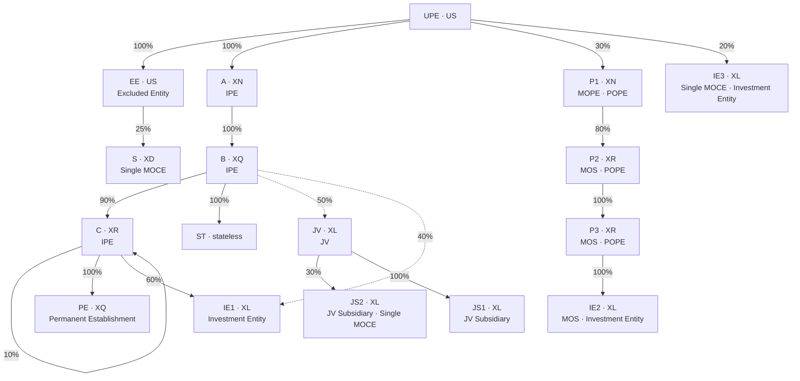

# Example

This example follows one group of 17 Entities, headed by a US parent, through the Calculation Model: from its ownership structure to the classification of each Entity, the groups in which amounts are aggregated, and the jurisdictions that may collect Top-up Tax. The group is built to contain every case the documents distinguish.

Each section applies one document and links to it; the symbols are defined there. Jurisdiction codes other than US are placeholders, and what each jurisdiction has implemented is an assumption.

# Terms

| Term | Meaning | Defined in |
| --- | --- | --- |
| UPE | Ultimate Parent Entity: the Entity at the top of the group | Input |
| CE | Constituent Entity: an Entity of the group that is subject to the rules | Input |
| Excluded Entity | An Entity outside the rules, such as a pension fund | Input |
| PE | Permanent Establishment: a branch treated as a separate Entity | Input |
| Investment Entity | A fund or similar Entity, calculated separately | Input |
| Stateless Entity | An Entity located in no jurisdiction | Input |
| JV, JV Subsidiary | An equity-method Entity held at least 50% by the UPE, and the Entities it controls | [JV](JV.md) |
| MOCE | Minority-Owned Constituent Entity: held 30% or less by the UPE | [MOSG](MOSG.md) |
| MOPE, MOS | The top MOCE of a Minority-Owned Subgroup, and the MOCEs it controls | [MOSG](MOSG.md) |
| Single MOCE | A MOCE outside every Minority-Owned Subgroup | [MOSG](MOSG.md) |
| IPE | Intermediate Parent Entity: a CE that owns another CE | [Taxing Rights](<Taxing Rights.md#identification-of-parent-entities>) |
| POPE | Partially-Owned Parent Entity: a parent more than 20% owned outside the group | [Taxing Rights](<Taxing Rights.md#identification-of-parent-entities>) |
| IIR | Income Inclusion Rule: a Parent Entity pays the Top-up Tax of the Entities it owns | [Taxing Rights](<Taxing Rights.md#iir-payability>) |
| UTPR | Undertaxed Profits Rule: collects Top-up Tax that no IIR collects | [Taxing Rights](<Taxing Rights.md#utpr-taxing-rights>) |
| QDMTT | Qualified Domestic Minimum Top-up Tax: a jurisdiction collects the Top-up Tax of its own Entities | [Taxing Rights](<Taxing Rights.md#qdmtt-taxing-rights>) |
| TCSH | Transitional CbCR Safe Harbour: a simplified test that can set Top-up Tax to zero | [TCSH](<Transitional CbCR Safe Harbours Test.md>) |

# Jurisdictions

| Code | IIR | Qualified IIR | Domestic IIR | Self IIR | UTPR | QDMTT |
| --- | --- | --- | --- | --- | --- | --- |
| US | – | – | – | – | – | – |
| XN | ✓ | – | ✓ | ✓ | – | – |
| XQ | ✓ | ✓ | ✓ | – | ✓ | ✓ |
| XR | ✓ | ✓ | – | – | – | – |
| XD | – | – | – | – | – | ✓ |
| XL | – | – | – | – | – | – |

What a jurisdiction has implemented decides which Parent Entities can be charged. A Qualified IIR is one recognised as equivalent to the model rules, and a Domestic IIR also applies to low-taxed Entities in the Parent Entity's own jurisdiction. A Self IIR is a domestic IIR under which a Parent Entity can pay its own Top-up Tax.

# Ownership Structure

A solid arrow is a direct Ownership Interest held together with direct control; a dashed arrow is an Ownership Interest without control. The arrow from C to itself is treasury shares. Interests not shown are held outside the group. JV is reported under the equity method and has no controller.

# Matrices

The structure above as the two input matrices of the model, and the two matrices the model derives from them. Entry $(i,j)$ of an ownership matrix is the share of Entity $j$ held by Entity $i$; entry $(i,j)$ of a control matrix is 1 when Entity $i$ controls Entity $j$. Rows and columns follow the Entity index $i$ in [Entities](#entities), and a dot is 0.

**Direct Ownership Interest matrix** $\mathbf{X}_0$

The arrows of the diagram, with their percentages. Input; see [Ownership Interest](<Ownership Interest.md#direct-ownership-matrix>).

$$
\scriptsize
\begin{array}{r|ccccccccccccccccc}
 & 1 & 2 & 3 & 4 & 5 & 6 & 7 & 8 & 9 & 10 & 11 & 12 & 13 & 14 & 15 & 16 & 17 \\ \hline
\text{1 UPE} & \cdot & 1 & 1 & \cdot & \cdot & \cdot & \cdot & \cdot & \cdot & \cdot & \cdot & 0.3 & \cdot & \cdot & \cdot & \cdot & 0.2 \\
\text{2 EE} & \cdot & \cdot & \cdot & \cdot & \cdot & \cdot & \cdot & \cdot & \cdot & \cdot & \cdot & \cdot & \cdot & \cdot & \cdot & 0.25 & \cdot \\
\text{3 A} & \cdot & \cdot & \cdot & 1 & \cdot & \cdot & \cdot & \cdot & \cdot & \cdot & \cdot & \cdot & \cdot & \cdot & \cdot & \cdot & \cdot \\
\text{4 B} & \cdot & \cdot & \cdot & \cdot & 0.9 & \cdot & 0.4 & 1 & 0.5 & \cdot & \cdot & \cdot & \cdot & \cdot & \cdot & \cdot & \cdot \\
\text{5 C} & \cdot & \cdot & \cdot & \cdot & 0.1 & 1 & 0.6 & \cdot & \cdot & \cdot & \cdot & \cdot & \cdot & \cdot & \cdot & \cdot & \cdot \\
\text{6 PE} & \cdot & \cdot & \cdot & \cdot & \cdot & \cdot & \cdot & \cdot & \cdot & \cdot & \cdot & \cdot & \cdot & \cdot & \cdot & \cdot & \cdot \\
\text{7 IE1} & \cdot & \cdot & \cdot & \cdot & \cdot & \cdot & \cdot & \cdot & \cdot & \cdot & \cdot & \cdot & \cdot & \cdot & \cdot & \cdot & \cdot \\
\text{8 ST} & \cdot & \cdot & \cdot & \cdot & \cdot & \cdot & \cdot & \cdot & \cdot & \cdot & \cdot & \cdot & \cdot & \cdot & \cdot & \cdot & \cdot \\
\text{9 JV} & \cdot & \cdot & \cdot & \cdot & \cdot & \cdot & \cdot & \cdot & \cdot & 1 & 0.3 & \cdot & \cdot & \cdot & \cdot & \cdot & \cdot \\
\text{10 JS1} & \cdot & \cdot & \cdot & \cdot & \cdot & \cdot & \cdot & \cdot & \cdot & \cdot & \cdot & \cdot & \cdot & \cdot & \cdot & \cdot & \cdot \\
\text{11 JS2} & \cdot & \cdot & \cdot & \cdot & \cdot & \cdot & \cdot & \cdot & \cdot & \cdot & \cdot & \cdot & \cdot & \cdot & \cdot & \cdot & \cdot \\
\text{12 P1} & \cdot & \cdot & \cdot & \cdot & \cdot & \cdot & \cdot & \cdot & \cdot & \cdot & \cdot & \cdot & 0.8 & \cdot & \cdot & \cdot & \cdot \\
\text{13 P2} & \cdot & \cdot & \cdot & \cdot & \cdot & \cdot & \cdot & \cdot & \cdot & \cdot & \cdot & \cdot & \cdot & 1 & \cdot & \cdot & \cdot \\
\text{14 P3} & \cdot & \cdot & \cdot & \cdot & \cdot & \cdot & \cdot & \cdot & \cdot & \cdot & \cdot & \cdot & \cdot & \cdot & 1 & \cdot & \cdot \\
\text{15 IE2} & \cdot & \cdot & \cdot & \cdot & \cdot & \cdot & \cdot & \cdot & \cdot & \cdot & \cdot & \cdot & \cdot & \cdot & \cdot & \cdot & \cdot \\
\text{16 S} & \cdot & \cdot & \cdot & \cdot & \cdot & \cdot & \cdot & \cdot & \cdot & \cdot & \cdot & \cdot & \cdot & \cdot & \cdot & \cdot & \cdot \\
\text{17 IE3} & \cdot & \cdot & \cdot & \cdot & \cdot & \cdot & \cdot & \cdot & \cdot & \cdot & \cdot & \cdot & \cdot & \cdot & \cdot & \cdot & \cdot \\
\end{array}
$$

**Direct and indirect Ownership Interest matrix** $\mathbf{Y}=f(\mathbf{X}_0)$

$f$ is the [direct method of Ownership Interest](<Ownership Interest.md#direct-method>). It adds up every ownership path, so that $(\mathbf{Y})_{ij}$ is the total share of Entity $j$ that Entity $i$ holds, directly and through other Entities.

$$
\scriptsize
\begin{array}{r|ccccccccccccccccc}
 & 1 & 2 & 3 & 4 & 5 & 6 & 7 & 8 & 9 & 10 & 11 & 12 & 13 & 14 & 15 & 16 & 17 \\ \hline
\text{1 UPE} & \cdot & 1 & 1 & 1 & 1 & 1 & 1 & 1 & 0.5 & 0.5 & 0.15 & 0.3 & 0.24 & 0.24 & 0.24 & 0.25 & 0.2 \\
\text{2 EE} & \cdot & \cdot & \cdot & \cdot & \cdot & \cdot & \cdot & \cdot & \cdot & \cdot & \cdot & \cdot & \cdot & \cdot & \cdot & 0.25 & \cdot \\
\text{3 A} & \cdot & \cdot & \cdot & 1 & 1 & 1 & 1 & 1 & 0.5 & 0.5 & 0.15 & \cdot & \cdot & \cdot & \cdot & \cdot & \cdot \\
\text{4 B} & \cdot & \cdot & \cdot & \cdot & 1 & 1 & 1 & 1 & 0.5 & 0.5 & 0.15 & \cdot & \cdot & \cdot & \cdot & \cdot & \cdot \\
\text{5 C} & \cdot & \cdot & \cdot & \cdot & 0.1 & 1 & 0.6 & \cdot & \cdot & \cdot & \cdot & \cdot & \cdot & \cdot & \cdot & \cdot & \cdot \\
\text{6 PE} & \cdot & \cdot & \cdot & \cdot & \cdot & \cdot & \cdot & \cdot & \cdot & \cdot & \cdot & \cdot & \cdot & \cdot & \cdot & \cdot & \cdot \\
\text{7 IE1} & \cdot & \cdot & \cdot & \cdot & \cdot & \cdot & \cdot & \cdot & \cdot & \cdot & \cdot & \cdot & \cdot & \cdot & \cdot & \cdot & \cdot \\
\text{8 ST} & \cdot & \cdot & \cdot & \cdot & \cdot & \cdot & \cdot & \cdot & \cdot & \cdot & \cdot & \cdot & \cdot & \cdot & \cdot & \cdot & \cdot \\
\text{9 JV} & \cdot & \cdot & \cdot & \cdot & \cdot & \cdot & \cdot & \cdot & \cdot & 1 & 0.3 & \cdot & \cdot & \cdot & \cdot & \cdot & \cdot \\
\text{10 JS1} & \cdot & \cdot & \cdot & \cdot & \cdot & \cdot & \cdot & \cdot & \cdot & \cdot & \cdot & \cdot & \cdot & \cdot & \cdot & \cdot & \cdot \\
\text{11 JS2} & \cdot & \cdot & \cdot & \cdot & \cdot & \cdot & \cdot & \cdot & \cdot & \cdot & \cdot & \cdot & \cdot & \cdot & \cdot & \cdot & \cdot \\
\text{12 P1} & \cdot & \cdot & \cdot & \cdot & \cdot & \cdot & \cdot & \cdot & \cdot & \cdot & \cdot & \cdot & 0.8 & 0.8 & 0.8 & \cdot & \cdot \\
\text{13 P2} & \cdot & \cdot & \cdot & \cdot & \cdot & \cdot & \cdot & \cdot & \cdot & \cdot & \cdot & \cdot & \cdot & 1 & 1 & \cdot & \cdot \\
\text{14 P3} & \cdot & \cdot & \cdot & \cdot & \cdot & \cdot & \cdot & \cdot & \cdot & \cdot & \cdot & \cdot & \cdot & \cdot & 1 & \cdot & \cdot \\
\text{15 IE2} & \cdot & \cdot & \cdot & \cdot & \cdot & \cdot & \cdot & \cdot & \cdot & \cdot & \cdot & \cdot & \cdot & \cdot & \cdot & \cdot & \cdot \\
\text{16 S} & \cdot & \cdot & \cdot & \cdot & \cdot & \cdot & \cdot & \cdot & \cdot & \cdot & \cdot & \cdot & \cdot & \cdot & \cdot & \cdot & \cdot \\
\text{17 IE3} & \cdot & \cdot & \cdot & \cdot & \cdot & \cdot & \cdot & \cdot & \cdot & \cdot & \cdot & \cdot & \cdot & \cdot & \cdot & \cdot & \cdot \\
\end{array}
$$

- C holds 10% of itself, so B's 90% is the whole of the outstanding interest: $(\mathbf{Y})_{4,5}=1$, and the treasury shares remain on the diagonal as $(\mathbf{Y})_{5,5}=0.1$.
- IE1 has two shareholders: $(\mathbf{Y})_{4,7}=0.4+1\times0.6=1$ for B, and $(\mathbf{Y})_{5,7}=0.6$ for C.

**Direct Controlling Interest matrix** $\mathbf{C}_0$

The solid arrows of the diagram. Input; see [Controlling Interest](<Ownership Interest.md#direct-controlling-matrix>).

$$
\scriptsize
\begin{array}{r|ccccccccccccccccc}
 & 1 & 2 & 3 & 4 & 5 & 6 & 7 & 8 & 9 & 10 & 11 & 12 & 13 & 14 & 15 & 16 & 17 \\ \hline
\text{1 UPE} & \cdot & 1 & 1 & \cdot & \cdot & \cdot & \cdot & \cdot & \cdot & \cdot & \cdot & 1 & \cdot & \cdot & \cdot & \cdot & 1 \\
\text{2 EE} & \cdot & \cdot & \cdot & \cdot & \cdot & \cdot & \cdot & \cdot & \cdot & \cdot & \cdot & \cdot & \cdot & \cdot & \cdot & 1 & \cdot \\
\text{3 A} & \cdot & \cdot & \cdot & 1 & \cdot & \cdot & \cdot & \cdot & \cdot & \cdot & \cdot & \cdot & \cdot & \cdot & \cdot & \cdot & \cdot \\
\text{4 B} & \cdot & \cdot & \cdot & \cdot & 1 & \cdot & \cdot & 1 & \cdot & \cdot & \cdot & \cdot & \cdot & \cdot & \cdot & \cdot & \cdot \\
\text{5 C} & \cdot & \cdot & \cdot & \cdot & \cdot & 1 & 1 & \cdot & \cdot & \cdot & \cdot & \cdot & \cdot & \cdot & \cdot & \cdot & \cdot \\
\text{6 PE} & \cdot & \cdot & \cdot & \cdot & \cdot & \cdot & \cdot & \cdot & \cdot & \cdot & \cdot & \cdot & \cdot & \cdot & \cdot & \cdot & \cdot \\
\text{7 IE1} & \cdot & \cdot & \cdot & \cdot & \cdot & \cdot & \cdot & \cdot & \cdot & \cdot & \cdot & \cdot & \cdot & \cdot & \cdot & \cdot & \cdot \\
\text{8 ST} & \cdot & \cdot & \cdot & \cdot & \cdot & \cdot & \cdot & \cdot & \cdot & \cdot & \cdot & \cdot & \cdot & \cdot & \cdot & \cdot & \cdot \\
\text{9 JV} & \cdot & \cdot & \cdot & \cdot & \cdot & \cdot & \cdot & \cdot & \cdot & 1 & 1 & \cdot & \cdot & \cdot & \cdot & \cdot & \cdot \\
\text{10 JS1} & \cdot & \cdot & \cdot & \cdot & \cdot & \cdot & \cdot & \cdot & \cdot & \cdot & \cdot & \cdot & \cdot & \cdot & \cdot & \cdot & \cdot \\
\text{11 JS2} & \cdot & \cdot & \cdot & \cdot & \cdot & \cdot & \cdot & \cdot & \cdot & \cdot & \cdot & \cdot & \cdot & \cdot & \cdot & \cdot & \cdot \\
\text{12 P1} & \cdot & \cdot & \cdot & \cdot & \cdot & \cdot & \cdot & \cdot & \cdot & \cdot & \cdot & \cdot & 1 & \cdot & \cdot & \cdot & \cdot \\
\text{13 P2} & \cdot & \cdot & \cdot & \cdot & \cdot & \cdot & \cdot & \cdot & \cdot & \cdot & \cdot & \cdot & \cdot & 1 & \cdot & \cdot & \cdot \\
\text{14 P3} & \cdot & \cdot & \cdot & \cdot & \cdot & \cdot & \cdot & \cdot & \cdot & \cdot & \cdot & \cdot & \cdot & \cdot & 1 & \cdot & \cdot \\
\text{15 IE2} & \cdot & \cdot & \cdot & \cdot & \cdot & \cdot & \cdot & \cdot & \cdot & \cdot & \cdot & \cdot & \cdot & \cdot & \cdot & \cdot & \cdot \\
\text{16 S} & \cdot & \cdot & \cdot & \cdot & \cdot & \cdot & \cdot & \cdot & \cdot & \cdot & \cdot & \cdot & \cdot & \cdot & \cdot & \cdot & \cdot \\
\text{17 IE3} & \cdot & \cdot & \cdot & \cdot & \cdot & \cdot & \cdot & \cdot & \cdot & \cdot & \cdot & \cdot & \cdot & \cdot & \cdot & \cdot & \cdot \\
\end{array}
$$

**Direct and indirect Controlling Interest matrix** $\mathbf{C}=w(\mathbf{C}_0)$

$w$ is [Warshall's algorithm](<Ownership Interest.md#warshalls-algorithm>). $(\mathbf{C})_{ij}$ is 1 when Entity $i$ controls Entity $j$ directly or through a chain of controlled Entities.

$$
\scriptsize
\begin{array}{r|ccccccccccccccccc}
 & 1 & 2 & 3 & 4 & 5 & 6 & 7 & 8 & 9 & 10 & 11 & 12 & 13 & 14 & 15 & 16 & 17 \\ \hline
\text{1 UPE} & \cdot & 1 & 1 & 1 & 1 & 1 & 1 & 1 & \cdot & \cdot & \cdot & 1 & 1 & 1 & 1 & 1 & 1 \\
\text{2 EE} & \cdot & \cdot & \cdot & \cdot & \cdot & \cdot & \cdot & \cdot & \cdot & \cdot & \cdot & \cdot & \cdot & \cdot & \cdot & 1 & \cdot \\
\text{3 A} & \cdot & \cdot & \cdot & 1 & 1 & 1 & 1 & 1 & \cdot & \cdot & \cdot & \cdot & \cdot & \cdot & \cdot & \cdot & \cdot \\
\text{4 B} & \cdot & \cdot & \cdot & \cdot & 1 & 1 & 1 & 1 & \cdot & \cdot & \cdot & \cdot & \cdot & \cdot & \cdot & \cdot & \cdot \\
\text{5 C} & \cdot & \cdot & \cdot & \cdot & \cdot & 1 & 1 & \cdot & \cdot & \cdot & \cdot & \cdot & \cdot & \cdot & \cdot & \cdot & \cdot \\
\text{6 PE} & \cdot & \cdot & \cdot & \cdot & \cdot & \cdot & \cdot & \cdot & \cdot & \cdot & \cdot & \cdot & \cdot & \cdot & \cdot & \cdot & \cdot \\
\text{7 IE1} & \cdot & \cdot & \cdot & \cdot & \cdot & \cdot & \cdot & \cdot & \cdot & \cdot & \cdot & \cdot & \cdot & \cdot & \cdot & \cdot & \cdot \\
\text{8 ST} & \cdot & \cdot & \cdot & \cdot & \cdot & \cdot & \cdot & \cdot & \cdot & \cdot & \cdot & \cdot & \cdot & \cdot & \cdot & \cdot & \cdot \\
\text{9 JV} & \cdot & \cdot & \cdot & \cdot & \cdot & \cdot & \cdot & \cdot & \cdot & 1 & 1 & \cdot & \cdot & \cdot & \cdot & \cdot & \cdot \\
\text{10 JS1} & \cdot & \cdot & \cdot & \cdot & \cdot & \cdot & \cdot & \cdot & \cdot & \cdot & \cdot & \cdot & \cdot & \cdot & \cdot & \cdot & \cdot \\
\text{11 JS2} & \cdot & \cdot & \cdot & \cdot & \cdot & \cdot & \cdot & \cdot & \cdot & \cdot & \cdot & \cdot & \cdot & \cdot & \cdot & \cdot & \cdot \\
\text{12 P1} & \cdot & \cdot & \cdot & \cdot & \cdot & \cdot & \cdot & \cdot & \cdot & \cdot & \cdot & \cdot & 1 & 1 & 1 & \cdot & \cdot \\
\text{13 P2} & \cdot & \cdot & \cdot & \cdot & \cdot & \cdot & \cdot & \cdot & \cdot & \cdot & \cdot & \cdot & \cdot & 1 & 1 & \cdot & \cdot \\
\text{14 P3} & \cdot & \cdot & \cdot & \cdot & \cdot & \cdot & \cdot & \cdot & \cdot & \cdot & \cdot & \cdot & \cdot & \cdot & 1 & \cdot & \cdot \\
\text{15 IE2} & \cdot & \cdot & \cdot & \cdot & \cdot & \cdot & \cdot & \cdot & \cdot & \cdot & \cdot & \cdot & \cdot & \cdot & \cdot & \cdot & \cdot \\
\text{16 S} & \cdot & \cdot & \cdot & \cdot & \cdot & \cdot & \cdot & \cdot & \cdot & \cdot & \cdot & \cdot & \cdot & \cdot & \cdot & \cdot & \cdot \\
\text{17 IE3} & \cdot & \cdot & \cdot & \cdot & \cdot & \cdot & \cdot & \cdot & \cdot & \cdot & \cdot & \cdot & \cdot & \cdot & \cdot & \cdot & \cdot \\
\end{array}
$$

# Entities

One row per Entity. *Given* is input; every other column is derived from the matrices above.

- **$\mathbf{upe\text{-}ownership}$** is the share held by the UPE, directly and indirectly: row 1 of $\mathbf{Y}$. See [JV](JV.md#calculation).
- **JV / MOCE** is the result of [JV](JV.md#calculation) and [MOSG](MOSG.md#calculation).
- **Parent** is the kind of Parent Entity, from [Taxing Rights](<Taxing Rights.md#identification-of-parent-entities>).
- **$\mathbf{group\text{-}id}$**, **TCSH Group**, and **ETR Calculation Group** come from [Group](Group.md). Entities with the same group number are aggregated together: once for the safe harbour test and once for the effective tax rate.

| $i$ | Entity | Jurisdiction | Given | $\mathbf{upe\text{-}ownership}$ | JV / MOCE | Parent | $\mathbf{group\text{-}id}$ | TCSH Group | ETR Calculation Group |
| --- | --- | --- | --- | --- | --- | --- | --- | --- | --- |
| 1 | UPE | US | CE, UPE | – | – | UPE | 0 | 1 | 1 |
| 2 | EE | US | Excluded Entity | 1 | – | – | 0 | – | – |
| 3 | A | XN | CE | 1 | – | IPE | 0 | 2 | 2 |
| 4 | B | XQ | CE | 1 | – | IPE | 0 | 3 | 3 |
| 5 | C | XR | CE | 1 | – | IPE | 0 | 4 | 4 |
| 6 | PE | XQ | CE, PE | 1 | – | – | 0 | 3 | 3 |
| 7 | IE1 | XL | CE, Investment Entity | 1 | – | – | 0 | – | 5 |
| 8 | ST | – | CE, Stateless | 1 | – | – | 8 | – | 6 |
| 9 | JV | XL | Equity method | 0.5 | JV | – | 9 | 5 | 7 |
| 10 | JS1 | XL | – | 0.5 | JV Subsidiary | – | 9 | 5 | 7 |
| 11 | JS2 | XL | – | 0.15 | JV Subsidiary, Single MOCE | – | 11 | 5 | 8 |
| 12 | P1 | XN | CE | 0.3 | MOPE | POPE | 12 | 2 | 9 |
| 13 | P2 | XR | CE | 0.24 | MOS | POPE | 12 | 4 | 10 |
| 14 | P3 | XR | CE | 0.24 | MOS | POPE | 12 | 4 | 10 |
| 15 | IE2 | XL | CE, Investment Entity | 0.24 | MOS | – | 12 | – | 11 |
| 16 | S | XD | CE | 0.25 | Single MOCE | – | 16 | 6 | 12 |
| 17 | IE3 | XL | CE, Investment Entity | 0.2 | Single MOCE | – | 0 | – | 5 |

- JS2 is a MOCE through $\mathbf{jv\text{-}ownership}=0.3$, the share held by its JV, not through $\mathbf{upe\text{-}ownership}$.
- $\mathbf{external}$, the share of a parent's profits held outside the group, is 0 for A, B, and C, 0.7 for P1, and 0.76 for P2 and P3. Above 0.2 a parent is a POPE.
- JV, JS1, and JS2 form one TCSH Group but two ETR Calculation Groups, because only the latter distinguishes MOCEs.
- P1 is tested with A, and P2 and P3 with C, for TCSH; for the ETR they are separated by $\mathbf{group\text{-}id}=12$.
- IE2 shares $\mathbf{group\text{-}id}=12$ with its Minority-Owned Subgroup but forms its own ETR Calculation Group through $\operatorname{eq}(\mathbf{ie})$.
- IE3 is a Single MOCE, yet joins IE1 in the Investment Entity group of XL.

# IIR Payability

Which Parent Entity may be charged the Top-up Tax of which Entity, from [Taxing Rights](<Taxing Rights.md#iir-payability>). A Parent Entity is payable for an Entity in which it holds an interest if its jurisdiction has an IIR and no Parent Entity above it takes priority.

| Parent | Type | Payable for | Not payable for |
| --- | --- | --- | --- |
| UPE | UPE | – | All: US has no IIR. |
| A | IPE | A itself, B, C, PE, IE1, ST, JV, JS1, JS2 | – |
| B | IPE | C, PE, IE1, ST, JV, JS1, JS2 | – |
| C | IPE | – | PE, IE1: displaced by B, an upper IPE with a Qualified IIR. |
| P1 | POPE | P1 itself, P2, P3, IE2 | – |
| P2 | POPE | IE2 | P3: same jurisdiction, and XR has no domestic IIR. |
| P3 | POPE | – | IE2: displaced by P2, a wholly-owning upper POPE with a Qualified IIR. |

- A does not displace B, because the IIR of XN is not qualified. Both are payable, and the overlap is resolved by the offset in [IIR](IIR.md).
- B is payable for PE in its own jurisdiction, because XQ applies its IIR domestically.
- P1 does not displace P2, because it holds only 80% of P2.
- B is payable for the JV Group and for the Stateless Entity ST.
- A and P1 pay their own Top-up Tax ($\mathbf{self\text{-}payable}$): XN allows it and no Parent Entity in XN is payable for them. For A, an IPE, it also matters that no UPE is payable for it and no IPE in another jurisdiction controls it.

Aggregated to jurisdictions, $\mathbf{Iir\text{-}taxing\text{-}rights}$ is:

| Collecting jurisdiction | Over Entities in |
| --- | --- |
| XN | XN, XQ, XR, XL |
| XQ | XQ, XR, XL |
| XR | XL |

# Entities without an IIR-payable Parent

No IIR collects the Top-up Tax of these Entities. It falls to the QDMTT of the Entity's own jurisdiction where there is one, and otherwise to the UTPR.

| Entity | Jurisdiction | Taxing right |
| --- | --- | --- |
| S | XD | QDMTT of XD |
| UPE | US | UTPR |
| IE3 | XL | UTPR |

XQ is the only UTPR jurisdiction and has CEs other than Investment Entities (B and PE). XQ also applies its QDMTT to B and PE.

# Coverage

Each case the documents distinguish, and the Entity that shows it.

| Case | Where |
| --- | --- |
| UPE in a jurisdiction without an IIR | UPE |
| IPE with a non-qualified IIR, payable without displacing | A |
| IPE with a Qualified IIR, payable and displacing | B |
| IPE displaced under the top-down rule | C |
| POPE, payable | P1 |
| POPE under a non-wholly-owning upper POPE, payable | P2 |
| POPE displaced by a wholly-owning upper POPE | P3 |
| Domestic IIR applied / not applied | B → PE / P2 → P3 |
| Parent Entity paying its own Top-up Tax | A (IPE), P1 (POPE) |
| Two shareholders within the group | IE1 (B 40%, C 60%) |
| Treasury shares | C (10%) |
| Excluded Entity on an ownership path | EE → S |
| Permanent Establishment | PE |
| Investment Entity | IE1 |
| Stateless Entity | ST |
| JV, JV Subsidiary | JV, JS1 |
| MOCE below a JV | JS2 |
| MOPE, MOS | P1; P2, P3 |
| Investment Entity inside a Minority-Owned Subgroup | IE2 |
| Single MOCE | S |
| Single MOCE that is an Investment Entity | IE3 |
| QDMTT, UTPR | S; UPE, IE3 |

Not covered: circular ownership, an equity-method Entity below 50%, $\mathbf{jv\text{-}excluded}$, a Minority-Owned Subgroup below a JV, Article 7.4, and changes within the Fiscal Year.
