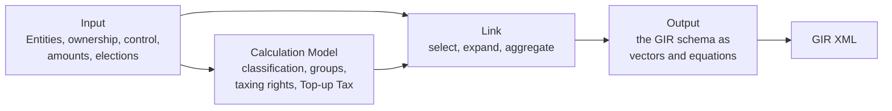

# OECD Pillar Two DX Model

A formal model of the OECD Pillar Two (GloBE) rules and of the GloBE Information Return (GIR). The rules, the return schema, and the mapping between them are written in one language: vectors, matrices, and the equations they satisfy.

## Why

- **Traceable.** Every classification and every amount is a formula of its inputs, so a result can be followed back to the rule that produced it.
- **Checkable.** A rule written as an equation can be evaluated on an example, tested on edge cases, and compared with another rule for consistency.
- **Small input.** Entities, direct ownership and control, Entity-level amounts, and elections are entered once. Everything else, including most of the return, is derived.

## How It Works

1. **[Input](GIR-Model/Input/Model.md)** holds only what cannot be derived: an Entity list, the direct Ownership Interest matrix $\mathbf{X}_0$, the direct Controlling Interest matrix $\mathbf{C}_0$, jurisdictions, and a few classification vectors.
2. **[Calculation Model](Calculation-Model/Workflow.md)** turns the input into results by matrix algebra: indirect ownership, JV Groups, Minority-Owned Subgroups, calculation groups, Parent Entities, and IIR payability.
3. **[Link](GIR-Model/Link/Model.md)** defines each atom of the return as a selection, expansion, or aggregation of inputs and results. It calculates nothing itself.
4. **[Output](GIR-Model/Output/Model.md)** is the GIR XSD rewritten as 84 relations, their vectors, and 782 equations. A document is schema-valid exactly when every equation holds.

Three lines give the flavour.

Direct ownership becomes direct and indirect ownership, with circular ownership and treasury shares resolved:

$$
\mathbf{E}:=\mathbf{X}_0(\mathbf{I}-\mathbf{X}_0)^{-1},\qquad
\mathbf{Y}:=(\mathbf{I}+\operatorname{diag}(\mathbf{E}))^{-1}\mathbf{E}
$$

A JV candidate is an equity-method Entity in which the UPEs hold at least 50%:

$$
\mathbf{jvc}:=\mathbf{eqt}\land(\mathbf{Y}^{T}\times\mathbf{group\text{-}upe}\ge0.5)\land\neg\mathbf{jv\text{-}excluded}
$$

The schema rule "a UPE is reported either as an Excluded UPE or as another UPE" is one equation over the UPE rows:

$$
\boldsymbol{\pi}_{\text{ExcludedUPE}}+\boldsymbol{\pi}_{\text{OtherUPE}}=\mathbf{1}
$$

## Start Here

- **[Example](Calculation-Model/Example.md)**: one 17-Entity group under a US UPE that exercises every classification, with its matrices, groups, and IIR payability worked out.
- **[Workflow](Calculation-Model/Workflow.md)**: the Calculation Model documents in the order they apply.
- **[Output equations](GIR-Model/Output/Equations.md)**: the return schema, relation by relation.

## Repository

| Path | Content |
| --- | --- |
| `Calculation-Model/` | The rules as matrix algebra, one document per step |
| `GIR-Model/Input/` | The normalized input atoms |
| `GIR-Model/Link/` | The link from input and results to the return, with scripts that check it against the XSD |
| `GIR-Model/Output/` | The return schema as vectors and equations, generated by `generate.py` |
| `GIR-Model/globe-xsd/` | The OECD GIR XSD |
| `GIR-Model/xml schema.pdf`, `.txt` | The OECD GIR XML Schema user guide |
| `GIR-Model/Model.md`, `Relations.md`, `*.csv`, `*.sql` | An earlier relational model of the same schema |
| `WORKFLOW.md` | The order in which safe harbours and charging rules apply |

## Status

This is work in progress.

- **Settled:** Ownership Interest, Controlling Interest, JV, MOSG, Group, Transitional CbCR Safe Harbour, Top-up Tax Calculation, Taxing Rights, UTPR, and the Output model of the whole schema.
- **Draft:** IIR.
- **Partial:** Input and Link cover `GeneralSection/CorporateStructure` and the frame of `JurisdictionSection`. On the example group the linked equations all hold, and the resulting XML is accepted by two XSD validators once the unlinked required fields are filled with test values.
- **Checked:** on random documents over the whole schema, "every Output equation holds" and "the XSD validators accept" have always coincided.
- **Not modelled:** changes of ownership or control within a Fiscal Year, and the Simplified ETR Safe Harbour.

## License

Original documentation and model specifications in this repository are licensed
under [Creative Commons Attribution-NonCommercial 4.0 International (CC BY-NC 4.0)](LICENSE),
unless otherwise noted. Attribution is required, and commercial use requires
separate permission from the copyright holder.
